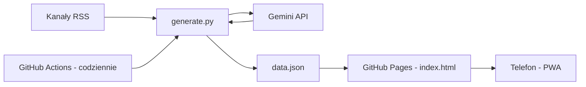

# BetelSpark

Codzienny skrót najważniejszych wiadomości ze świata AI, technologii i kosmosu. Po polsku, w trzech kliknięciach.

**Demo:** https://hessart.github.io/betelspark/


## Jak to działa



1. GitHub Actions codziennie uruchamia skrypt `generate.py`.
2. Skrypt pobiera kanały RSS (AI, Tech, Kosmos) i wybiera wpisy z ostatnich 48 godzin.
3. Jedno zbiorcze zapytanie do Gemini API streszcza i tłumaczy wiadomości na polski.
4. Wynik trafia do `data.json`, który bot automatycznie zapisuje w repozytorium.
5. Strona hostowana na GitHub Pages wczytuje `data.json`. Można ją zainstalować na ekranie głównym telefonu (PWA).

## Technologie

- Python: `feedparser`, `requests`, `google-genai`
- GitHub Actions (harmonogram, sekrety) i GitHub Pages
- HTML, CSS i JavaScript bez frameworków
- PWA: manifest i service worker
- Koszt utrzymania: 0 zł

## Wnioski z budowy projektu

- **Limity darmowego API.** Pierwsza wersja wysyłała trzy zapytania dziennie z wielokrotnym ponawianiem, co wyczerpało dzienny limit (błąd 429). Rozwiązanie: jedno zbiorcze zapytanie na dobę.
- **Awarie usług zewnętrznych.** Model bywa przeciążony (503). Skrypt próbuje kolejnych modeli z listy i robi przerwy między próbami.
- **Ochrona danych.** Gdy streszczenie się nie uda, skrypt kończy się błędem i nie nadpisuje poprzedniego `data.json`, dzięki czemu aplikacja nigdy nie traci dobrych danych.
- **Bezpieczeństwo kluczy.** Klucz API jest w GitHub Secrets, a lokalnie w pliku `.env` poza repozytorium.
- **Certyfikaty SSL.** Problem z niektórymi źródłami rozwiązany przez pobieranie kanałów biblioteką `requests`, bez wyłączania weryfikacji certyfikatów.

## Uruchomienie lokalne

```bash
git clone https://github.com/Hessart/betelspark.git
cd betelspark
python -m venv venv
venv\Scripts\activate
pip install -r requirements.txt
```

Utwórz plik `.env` z kluczem do Gemini API (darmowy w Google AI Studio):

```
GEMINI_API_KEY=twoj_klucz
```

Wygeneruj dane i uruchom stronę:

```bash
python generate.py
python -m http.server 8000
```

Strona będzie dostępna pod adresem http://localhost:8000.

## Ograniczenia

- Streszczenia generuje AI i mogą zawierać błędy. Każda wiadomość ma link do źródła.
- Darmowy poziom API ma limity i czasem bywa niedostępny.

## Plany

- Polskie źródła i kategoria „Polska"
- Filtrowanie biuletynów i powtórzeń tego samego tematu
- Osobne trackery postępów dla długich tematów
- Powiadomienia