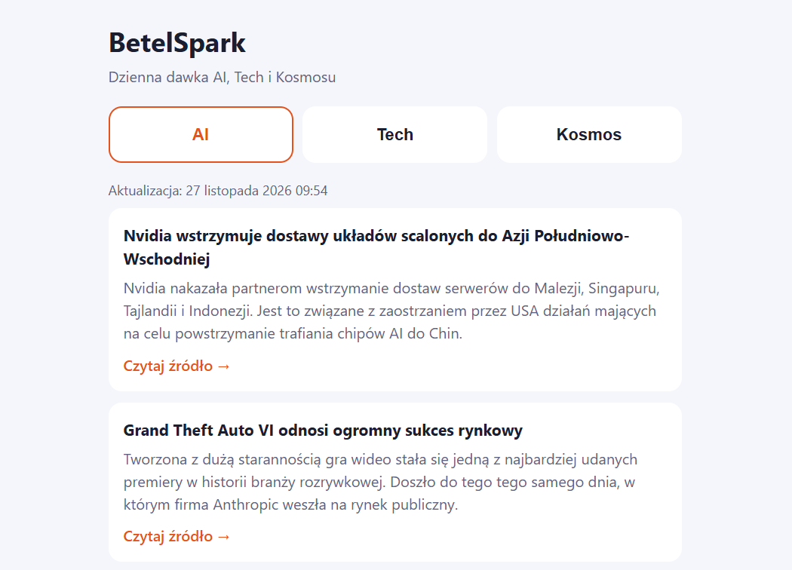
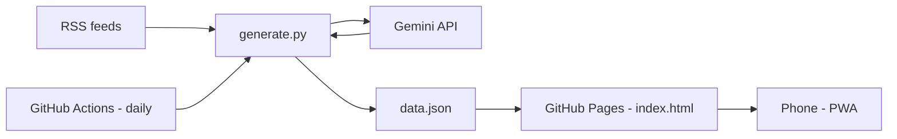

[Wersja polska](README.pl.md)

# BetelSpark

A daily digest of the most important news in AI, tech and space, summarized in Polish and available in three taps.

**Live demo:** https://hessart.github.io/betelspark/ (the interface and summaries are in Polish)



## How it works



1. GitHub Actions runs `generate.py` every day on a schedule.
2. The script fetches RSS feeds for three categories (AI, Tech, Space) and keeps entries from the last 48 hours.
3. A single batched request to the Gemini API summarizes and translates the news into Polish.
4. The result is saved to `data.json`, which a bot commits back to the repository.
5. A static page on GitHub Pages loads `data.json`. It can be installed on a phone's home screen as a PWA.

## Tech stack

- Python: `feedparser`, `requests`, `google-genai`
- GitHub Actions (scheduling, secrets) and GitHub Pages
- Plain HTML, CSS and JavaScript, no frameworks
- PWA: web app manifest and service worker
- Running cost: zero

## Lessons learned

- **Free API limits.** The first version sent three requests per day with multiple retries, which exhausted the daily quota (HTTP 429). Fix: one batched request per day.
- **Third-party outages.** The model is sometimes overloaded (HTTP 503). The script tries a list of fallback models and waits between attempts.
- **Protecting good data.** If summarization fails, the script exits with an error and does not overwrite the previous `data.json`, so the app never loses its last good data.
- **Secret handling.** The API key lives in GitHub Secrets, and locally in a `.env` file kept out of the repository.
- **SSL certificates.** An expired-certificate error from some feeds was solved by fetching them with `requests` instead of disabling certificate verification.

## Run locally

```bash
git clone https://github.com/Hessart/betelspark.git
cd betelspark
python -m venv venv
venv\Scripts\activate
pip install -r requirements.txt
```

Create a `.env` file with a Gemini API key (free in Google AI Studio):

```
GEMINI_API_KEY=your_key
```

Generate the data and serve the page:

```bash
python generate.py
python -m http.server 8000
```

The site will be available at http://localhost:8000.

## Limitations

- Summaries are AI-generated and may contain mistakes. Every item links to its source.
- The free API tier has usage limits and is occasionally unavailable.

## Roadmap

- Polish news sources and a "Poland" category
- Filtering newsletters and duplicate stories
- Progress trackers for long-running topics
- Notifications